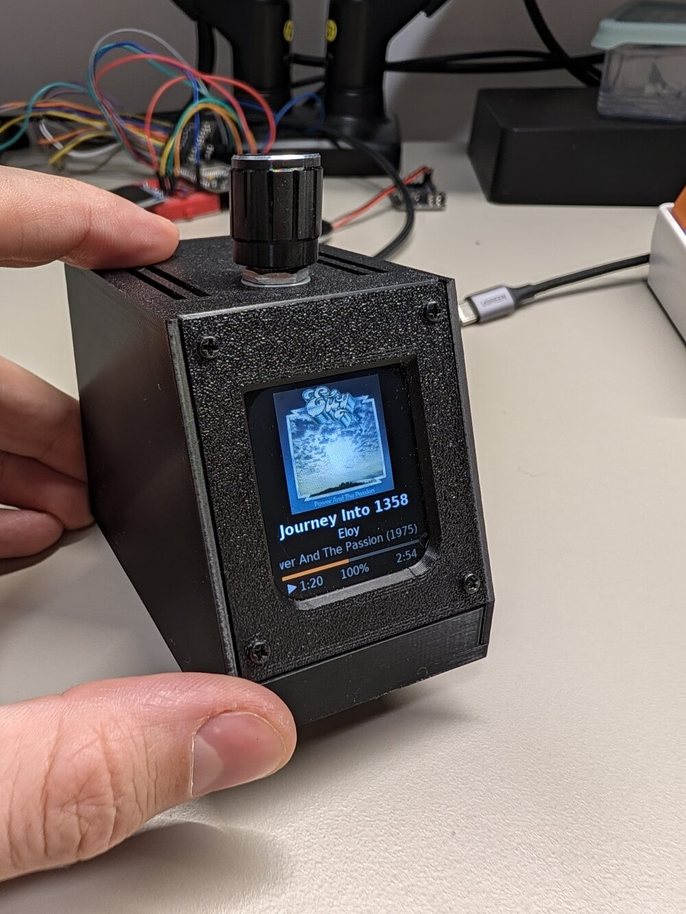

# Mukklet



A desk display that shows what [Mukk](https://github.com/Grigoriym/Mukk)
(a Linux music player, Kotlin/Compose Desktop) is playing: cover art,
title, artist, album and year, a progress bar, play state and volume. A
rotary knob on top controls the player.

An ESP32 drives a 1.69" 240x280 ST7789 colour TFT. Mukk connects to it
over WebSocket on the local network and does all the image work (crop,
scale, convert to RGB565), so the ESP32 never decodes JPEG or PNG and runs
fine without PSRAM. Written in C on ESP-IDF, with its own small canvas,
anti-aliased font renderer and UI code, no graphics library. It lives in a
3D-printed case (OpenSCAD model in [`enclosure/`](enclosure/README.md)).

## Screen

- **Playing / paused**: 160x160 cover at the top (grey placeholder until it
  arrives, about a second after a track change), then title, artist and
  album (year), each centred or scrolling if too long, a progress bar and a
  status row: play/pause icon, position, volume %, duration.
- **Waiting for Mukk** / **Nothing playing**: a pair of bored cartoon eyes
  that look around, blink, nod off and wake up again.
- If Mukk goes quiet for 15 s the display treats it as offline.

Text covers Latin, Latin Extended-A, Romanian, Cyrillic and typographic
punctuation (DejaVu Sans, 4-bit anti-aliased). Unknown characters draw as
a box.

## Knob

| Action | Does |
|---|---|
| Turn | Volume ±5 per detent (a fast spin is sent as one command) |
| Press | Play / pause |
| Double press | Next track |
| Long press (0.6-2 s) | Previous track |
| Hold 2 s | Screen off; any input wakes it |

## How it talks to Mukk

The ESP32 is a WebSocket server at `ws://mukklet.local/ws` (mDNS), Mukk is
the client. On connect the display sends `hello` with the cover size and
pixel format it wants; Mukk then sends track info, playback state and the
cover as binary frames, and the display sends back knob commands. LAN
only, no auth, one client at a time.

Full contract: [`docs/PROTOCOL.md`](docs/PROTOCOL.md), with example
messages in [`docs/protocol/`](docs/protocol/).

## Hardware

| Part | Notes |
|---|---|
| ESP32 mini (D1 mini layout, ESP32-WROOM-32, 4 MB flash, no PSRAM) | Any ESP32-WROOM DevKit works with the same GPIOs |
| 1.69" 240x280 ST7789V2 SPI TFT | 3.3 V only |
| KY-040 rotary encoder with push button | |
| Knob cap, Dupont cables, USB cable | |

| Signal | ESP32 GPIO |
|---|---|
| TFT SCL / SDA | 18 / 23 |
| TFT RES / DC / CS | 17 / 16 / 5 |
| TFT BLK (backlight, PWM) | 19 |
| Knob CLK / DT / SW | 27 / 25 / 32 |

Both modules run from 3V3. Full tables and cable layout:
[`docs/WIRING.md`](docs/WIRING.md).

## Build and flash

Requires [ESP-IDF](https://docs.espressif.com/projects/esp-idf/) v6.x.

```sh
cp main/wifi_secrets.h.example main/wifi_secrets.h   # SSID/password
. ~/esp/esp-idf/export.sh
idf.py -p /dev/ttyACM0 build flash
```

`main/wifi_secrets.h` is gitignored. After boot the display joins WiFi and
announces itself as `mukklet.local`; point Mukk at it (that is Mukk's
default).

Display settings in code: `FLIP_180` in `main/display.c` rotates the
screen (1 = upright with the TFT's pin header at the bottom, as in the
case); `EDGE_TEST` in `main/main.c` replaces the UI with test frames for
checking a case window against the lit area.

## Testing without the hardware or without Mukk

Both tools are Python, standard library only:

| Script | Does |
|---|---|
| `tools/fake_display.py` | Plays the ESP32 on the PC (`localhost:8765`): checks Mukk's messages against the protocol, dumps received covers as PNG, sends knob commands from the keyboard |
| `tools/fake_mukk.py [--host IP] [--seconds N]` | Plays Mukk against the real display: sends a small playlist (Cyrillic, a long title, missing tags, unknown duration) and obeys the knob |

## Development

CI (`.github/workflows/ci.yml`) runs the same checks on every push:

| Script | Does |
|---|---|
| `tools/test.sh` | Host unit tests for the pure modules (protocol, player state, UI, canvas, font, cover assembly, gestures, encoder decoding). `SHOW_ART=1` prints the rendered screens as ASCII art |
| `tools/format.sh` | clang-format (`--check` only reports) |
| `tools/lint.sh` | clang-tidy |
| `tools/size_check.sh` | Fails if the app partition has under 15% free |
| `tools/serial_log.py <seconds> "<regex>"` | Resets the board and captures/greps the boot log |
| `tools/gen_font.py` | Regenerates `main/font_data.c` (needs Pillow and fonts-dejavu-core) |

## Project layout

```
main/
  main.c        startup, main loop, knob gestures -> commands
  link.c        mDNS, HTTP server, WebSocket, cover buffer
  proto.c       parse/build protocol messages (pure, host-tested)
  player.c      session state, position extrapolation, offline rule (pure)
  ui.c          the screen from player state + time, incl. idle eyes (pure)
  canvas.c      RGB565 drawing into a band of the screen (pure)
  font.c        UTF-8 text rendering; font_data.c is generated
  cover.c       assembles cover-art binary frames (pure)
  display.c     ST7789 via esp_lcd, drawn in 20-row strips, backlight
  encoder.c     KY-040 ISR; encoder_decode.c, gesture.c (pure)
  wifi.c        WiFi station
test/           host unit tests
tools/          test, lint, format, size, serial, font and fake peers
docs/           protocol, wiring, the Mukk-side task
enclosure/      OpenSCAD case model, renders, assembly pages
```

## License

[Apache License 2.0](LICENSE)
